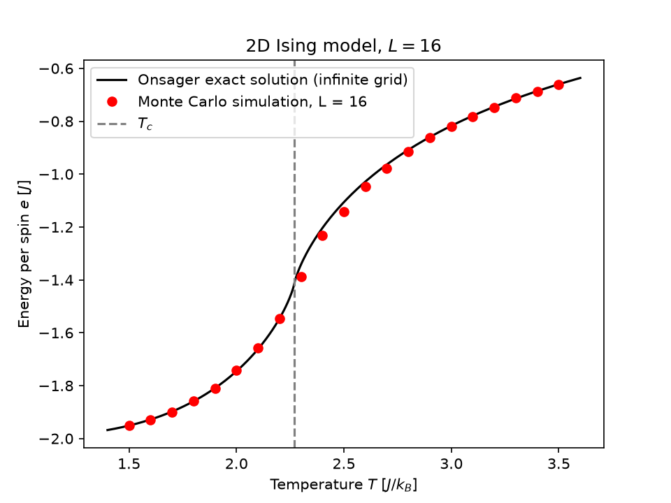

# 2D Ising Model: Monte Carlo Simulation

A Metropolis Monte Carlo simulation of the two-dimensional Ising model in C++,
with analysis in Python. The results are compared with Onsager's exact solution.

## The model

Spins $s_i = \pm 1$ sit on an $L \times L$ square grid with periodic boundaries.
The energy is $E = -J \sum_{\langle ij \rangle} s_i s_j$, in units where $J = k_B = 1$.
Below the critical temperature $T_c = 2/\ln(1+\sqrt{2}) \approx 2.269$, the spins
align spontaneously and the system becomes magnetized.

## Method

- Metropolis algorithm: single spin flips, accepted with probability $\min(1, e^{-\Delta E/T})$
- Temperature scan from $T = 3.5$ down to $1.5$ (cooling), on a $16 \times 16$ grid
- 1,000 equilibration sweeps, then 5,000 measurement sweeps per temperature
- Measured: average absolute magnetization $\langle |m| \rangle$ and energy per spin $e$

## Results


Below $T_c$ the simulation reproduces Onsager's exact magnetization, for example
$\langle |m| \rangle = 0.986$ at $T = 1.5$ (exact: $0.986$). Above $T_c$ the exact
magnetization is zero, but the finite grid stays partly ordered:
$\langle |m| \rangle = 0.66$ just above $T_c$ ($T = 2.3$), falling to $0.13$ at
$T = 3.5$. This is a finite-size effect.



The energy per spin follows the exact solution across the whole temperature range,
approaching $-\sqrt{2} \approx -1.41$ at $T_c$. It agrees better than the magnetization
because the energy depends only on neighboring spins, while the magnetization
measures order across the whole grid.

## How to run

Build and run the simulation from the repository root (writes `data/magnetization.csv`):

```
cmake -B build -DCMAKE_BUILD_TYPE=Release
cmake --build build
./build/ising
```

Plot the results (requires `numpy`, `matplotlib`, `scipy`):

```
python analysis/plot.py
```

## Structure

- `src/ising.cpp`: simulation
- `analysis/plot.py`: plots and comparison with the exact solution
- `data/`: simulation output

## Next steps

- Heat capacity and susceptibility from fluctuations
- Finite-size effects with $L = 16, 32, 64$
- Statistical error bars

---

*This README was written with the help of an AI assistant (Claude). Its content
was verified by me against the code and the simulation output.*