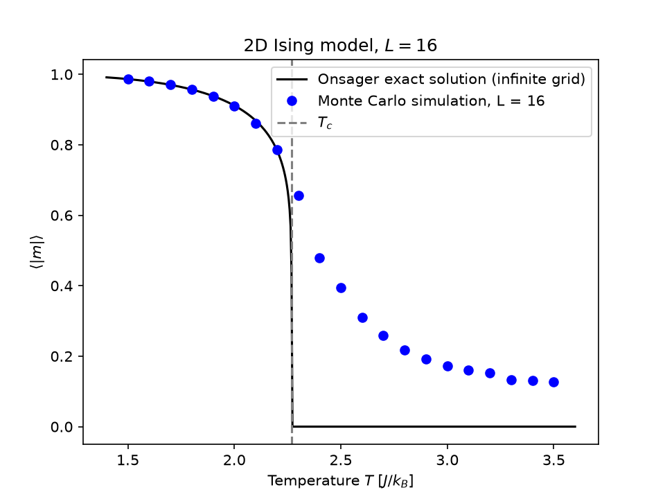

# ising-model
Monte Carlo simulation of the ising model (Metropolis Algorithm) in C++, with analysis in Python

## Results

Metropolis Monte Carlo on a 16×16 grid reproduces Onsager's exact
magnetization below the critical temperature T_c ≈ 2.269.
Above T_c the finite grid keeps a small magnetization, a finite-size effect.
